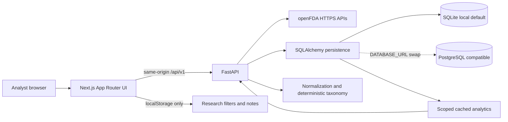

# Architecture

## Boundaries

- **Frontend**: presentation, chart/table interaction, URL/query state, and browser-only notebook persistence and exports. It never fabricates a metric when the API is empty or unavailable.
- **FastAPI**: openFDA request limits/retries, input/schema validation, field minimization, normalization, cache persistence, query scoping, aggregation, taxonomy, data freshness, and error reporting.
- **Persistence**: a shared `records` table stores source-discriminated, allowlisted records with stable source keys and retrieval times; `record_type` keeps adverse events, device recalls, enforcement reports, and classifications distinct. `source_status` tracks freshness/errors per source. SQLite is the zero-configuration local default; SQLAlchemy connection configuration supports a PostgreSQL URL.
- **Notebook**: localStorage contains only analyst-authored search filters, notes and source references. No backend account, sync, or patient-level data.

## Record linking

Exact product-code matching can connect an MDR report's reported device product code to a recall/classification product code. This is a generic-category association, not proof that an event involved the recalled product, model, batch, or marketed device. Manufacturer/product-name fuzzy joins are deliberately not performed. Recall and enforcement identifiers are not treated as interchangeable without an explicit source key.

## Refresh and on-demand search

The service caches bounded openFDA pages and normalizes only allowlisted fields. Search may fetch matching records when cache has no matching entries; explicit refresh supports bounded pages. A successful or failed refresh updates visible per-source freshness/status. A failed network request does not delete cached records. Full historical bulk synchronization is outside the local MVP.
